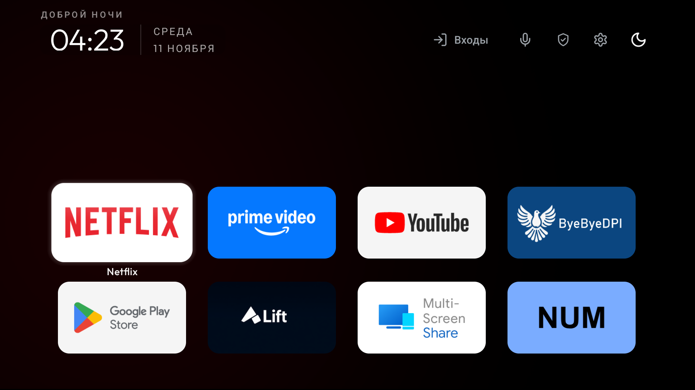
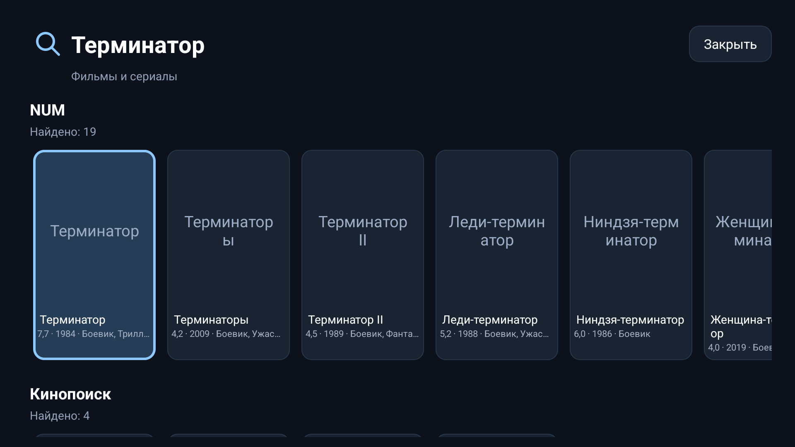
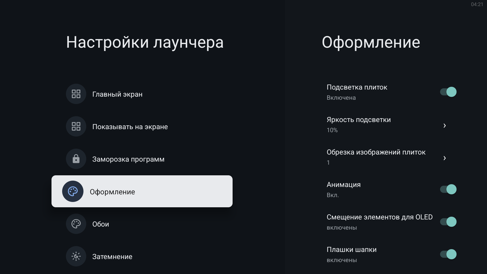
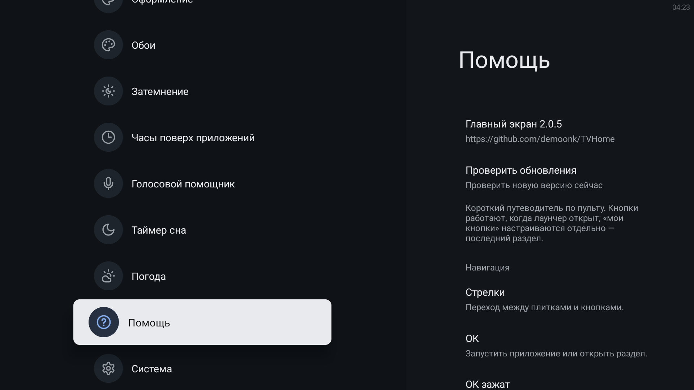

# TVHome

## Версия 2.0.4

Обновление устанавливается поверх TVHome 1.x и 2.x с сохранением данных и исходной подписи.

- Голосовой помощник прогревает движок распознавания, когда ассистент готов: первый запрос после включения не платит за холодный старт `com.google.android.tts:search` (на гостиной это было ~6.8 с против ~0.4 с на тёплом движке).
- Строки приложений без карточек получают кнопку «Искать в …» — только если поисковый вход приложения действительно достижим, иначе честную «Открыть …». Проверяются exported search активности и проверенные URL-правила (VK Видео, РешалаТВ, SmartTube, TizenTube).
- Ссылки из выдачи открываются на хосте, который приложение объявило в своих intent-filter: Кинопоиск `hd.kinopoisk.ru/film` и `kpatv://seasons`, VK Видео `vk.com/video-…`.
- В настройках, сразу после видимых программ, появился раздел «Заморозка программ» со списком безопасно отключаемых пакетов и командой `pm disable-user --user 0 <пакет>`. Лаунчер сам чужие пакеты не отключает.
- Установщик `Setup-TVHome.ps1`: помощник запускается через `setsid`, проверяется его pid-файл и живость процесса, и отдельная проверка — ответ на запрос `launcher:` (тот же путь, по которому голосовой источник выбирается из настроек TVHome). Проверяются разрешения, включая установку APK из неизвестных источников.
- Мостик пульта: короткое нажатие шестерёнки — настройки экрана, удержание (порог 700 мс) — настройки звука; физический Back возвращает в сохранённый поиск. Активности настроек проверяются на самом ТВ.
- Виджет погоды публикуется отдельным ассетом `TVHome-weather.apk`; установщик скачивает его с проверкой SHA-256, если ассет есть в релизе. Город выбирается в настройках TVHome (Погода).

Совместимость миграции, необязательный мостик физической кнопки Back и откат описаны в [переходе на 2.0.0](docs/migration-2.0.0.md).


Лаунчер для Android TV (Chiq-based TV, Dexp, Tuvio). Личный форк [CleanYourTV](https://github.com/Gathin23/cleanyourtv), MIT.



## Установка и настройка TVHome

**Первоначальную настройку Home и голосового поиска достаточно выполнить один раз.** Дальнейшие совместимые обновления лаунчера устанавливаются поверх существующей версии с сохранением данных и настроек: повторно назначать Home и выбирать голосового помощника обычно не потребуется. Если прошивка сбросила разрешения оверлейных часов, восстановите их по инструкции ниже. Для этого не удаляйте TVHome и не очищайте его данные перед обновлением.

### 1. Что понадобится

- Телевизор или приставка с Android 8.0 и новее.
- Компьютер с Windows и подключение к той же локальной сети.
- APK `TVHome-2.0.4.apk` из [последнего релиза](https://github.com/demoonk/TVHome/releases/latest).
- Android SDK Platform-Tools: https://developer.android.com/tools/releases/platform-tools

Для автоматической установки перейдите к пункту 2: APK и Platform-Tools установщик скачает сам. Для ручной установки распакуйте Platform-Tools. Положите APK в папку с `adb.exe`. Откройте эту папку в Проводнике, в адресной строке введите `powershell` и нажмите Enter. Все команды ниже выполняются в этом окне.

В примерах `IP:PORT` — адрес и порт подключения вашего телевизора. Заменяйте их во всех командах, например на `192.168.1.50:5555`. Порт 5555 используйте только если он соответствует настройкам вашего ТВ.

### 2. Автоматический установщик — одна команда PowerShell

**Откройте PowerShell на компьютере Windows, вставьте команду целиком и нажмите Enter:**

```powershell
$ErrorActionPreference = 'Stop'; $installer = Join-Path $env:TEMP 'Setup-TVHome.ps1'; [Net.ServicePointManager]::SecurityProtocol = [Net.SecurityProtocolType]::Tls12; Invoke-WebRequest -UseBasicParsing 'https://github.com/demoonk/TVHome/releases/latest/download/Setup-TVHome.ps1' -OutFile $installer; powershell -NoProfile -ExecutionPolicy Bypass -File $installer
```

Заранее скачивать APK и ADB не нужно. Установщик сам скачает официальный Android SDK Platform-Tools с сайта Google и последний APK TVHome из GitHub Releases, проверит SHA-256 приложения и:

1. Объяснит, как включить режим разработчика и отладку на ТВ.
2. Один раз запросит IP телевизора: в строке уже введено `192.168.1.`, весь адрес можно редактировать стрелками, Backspace и Delete. При необходимости допишите `:порт`; без него используется 5555.
3. Подключится через ADB по сети без запроса кода сопряжения. Подтвердите разрешение отладки на телевизоре. Если подключение не удалось, ответьте `1` для повтора или `0` для выхода; Enter означает `1`. Отладка, требующая кода сопряжения, этим установщиком не поддерживается.
4. Проверит Android 8.0+, сохранит прежний Home и настройки помощника в `previous-settings.json`, сделает доступную резервную копию установленного APK и установит TVHome с сохранением данных.
5. Выдаст и проверит разрешения для часов (`SYSTEM_ALERT_WINDOW`, `GET_USAGE_STATS`), микрофона (`RECORD_AUDIO`), переключения помощника (`WRITE_SECURE_SETTINGS`), имени сети в плашке (`ACCESS_FINE_LOCATION`) и установки APK из неизвестных источников (`REQUEST_INSTALL_PACKAGES`). Назначит и проверит TVHome как главный экран.
6. Если в выпуске есть APK виджета погоды (`TVHome-weather.apk`), скачает его с проверкой SHA-256 и установит с сохранением данных. Виджету нужен только `INTERNET`, оно выдаётся при установке и проверяется после неё. `-NoWeather` пропускает виджет; без контрольной суммы файл не устанавливается.
7. Если Google-компоненты есть, запустит и проверит ADB-помощник для переключения голосового режима: помощник запускается через `setsid` (`nohup` на части прошивок — только алиас, и pid-файл помощника не создаётся), проверяется, что процесс жив, и что он отвечает на запрос `launcher:` — тот же путь, по которому голосовой источник выбирается из настроек TVHome. Без ответа помощника выбор откатывается, поэтому установщик сообщает об этом отдельно. Если компонентов нет, сообщит, что голосовой режим недоступен; отсутствующие Google-компоненты установщик не устанавливает.
8. Заморозит списки через `pm disable-user --user 0`: `com.mediatek.wwtv.setupwizard` и `com.google.android.katniss`. Katniss замораживается только при переключении на помощника TVHome; защищённые пакеты (Home, настройки, тюнер, WebView, Google-сервисы, сам виджет) установщик не трогает. Список меняет `-Freeze`, откат — `Restore-Google.ps1` или `pm enable --user 0 <пакет>`. Пакет, которого нет на ТВ, пропускается; при незавершённой первоначальной настройке прошивки заморозка откладывается.
9. Откроет TVHome и покажет завершающие действия на телевизоре: включить оверлейные часы при необходимости; удержать OK на значке микрофона, выбрать «Google от лаунчера» и источник «Пульт» или «ТВ». Выбор этого голосового режима может отключить системного Google-помощника Katniss; возврат — выбор «Системный» в том же меню. Для строки погоды выберите город в настройках TVHome (Погода).

Источник «ТВ» требует Android 13+ и доступного встроенного микрофона. ADB-помощник работает до перезагрузки; для повторного переключения помощника после перезагрузки его нужно запустить снова (ручная команда есть ниже, либо повторно запустите установщик). Уже выбранный режим не обязательно перестаёт работать после перезагрузки.

Файлы, резервная копия APK и прежние настройки сохраняются в `%LOCALAPPDATA%\TVHome\Installer\<папка установки>`. При ошибке установщик останавливается и показывает её текст; выполненные шаги автоматически не откатываются. Резервная копия APK не содержит данные приложения. Проверьте Home, голос, удержание громкости и кнопку шестерёнки с пульта, затем при желании отключите отладку. Локальный установщик отключает Google Home (`com.google.android.apps.tv.launcherx`) только после проверки запуска TVHome, а Katniss — при переключении на помощника TVHome. Google TTS остаётся включённым. Службы доступности не включаются. Рядом с `previous-settings.json` сохраняется `Restore-Google.ps1` для возврата Google Home и помощника. Если роль главного экрана не назначена TVHome и TVHome не открылся, установщик включает Google Home обратно. Если роль назначена, но прошивка во время первоначальной настройки держит HOME за своей установочной активностью (например `com.google.android.tungsten.setupwraith/.RecoveryActivity`), установщик предупреждает и не откатывает назначение: Home проверяется после завершения настройки прошивки.

Ключ `-Offline` работает только с уже сохранённым кэшем: ADB, APK, `update.json` и контрольные суммы должны быть в `%LOCALAPPDATA%\TVHome\Installer\cache`. GitHub при этом не запрашивается, и файлы берутся из кэша с проверкой SHA-256.

[Скачать установщик отдельно](https://github.com/demoonk/TVHome/releases/latest/download/Setup-TVHome.ps1) · [Посмотреть исходный код](Setup-TVHome.ps1). Ручные способы установки и настройки сохранены далее.

Локальный установщик также поднимает мост для шестерёнки на совместимом пульте TVC0GWBT: скачивает DEX из релиза с проверкой SHA-256, использует сохранённый файл при повторном запуске и проверяет `PQ_REMOTE_READY`. Несовместимый пульт пропускается с предупреждением. Мост наблюдает события без захвата ввода и включения служб доступности; работает до перезагрузки ТВ. После перезагрузки запустите установщик снова. Проверьте шестерёнку, возврат Back из поиска и удержание громкости физическим пультом.

Одно нажатие шестерёнки открывает штатные настройки экрана, удержание (700 мс) — штатные настройки звука, сразу при достижении порога. Если настроек звука на прошивке нет, долгое нажатие открывает настройки экрана.

### 3. Подключение к телевизору

1. Включите режим разработчика на ТВ: обычно для этого нужно несколько раз нажать на пункт «Сборка» в сведениях об устройстве.
2. Включите доступную на вашей прошивке отладку по сети / ADB. Названия пунктов отличаются.
3. Узнайте IP-адрес и порт отладки телевизора.
4. На компьютере выполните:

```powershell
.\adb.exe connect IP:PORT
.\adb.exe devices
```

На телевизоре подтвердите разрешение отладки для своего компьютера. В списке устройств напротив адреса должно быть `device`.

Если телевизор использует беспроводную отладку с кодом сопряжения, сначала выполните:

```powershell
.\adb.exe pair IP:ПОРТ_СОПРЯЖЕНИЯ
```

Введите код с экрана ТВ, затем выполните `connect` с **портом подключения**. Порт сопряжения и порт подключения могут отличаться.

### 4. Установка или обновление

```powershell
.\adb.exe -s IP:PORT install -r .\TVHome-2.0.4.apk
```

Дождитесь `Success`. После успешной установки откройте TVHome:

```powershell
.\adb.exe -s IP:PORT shell am start -W -n ru.pda.tvhome/ru.pda.tvhome.MainActivity
```

Обновление ставится поверх совместимой версии с сохранением данных. При ошибке установки остановитесь и сохраните её текст. Для обновления не нужно удалять приложение или очищать его данные.

Если Home и голосовой поиск уже настроены, после успешного обновления дополнительные действия из разделов 5 и 6 не нужны.

### 5. Как назначить TVHome на кнопку Home

Если в меню телевизора нет выбора главного экрана, назначьте его с компьютера через ADB.

Сначала узнайте текущий главный экран и сохраните ответ — он понадобится для возврата:

```powershell
.\adb.exe -s IP:PORT shell cmd package resolve-activity --brief -a android.intent.action.MAIN -c android.intent.category.HOME
```

Нужна строка компонента вида `пакет/класс`. Если вместо штатного лаунчера показано окно выбора Android или непонятный результат, сохраните весь вывод: готовой команды возврата пока нет.

Назначьте TVHome:

```powershell
.\adb.exe -s IP:PORT shell cmd package set-home-activity ru.pda.tvhome/ru.pda.tvhome.MainActivity
```

Нажмите Home на пульте, затем проверьте Home из другого приложения и после перезагрузки ТВ.

Если команда завершается ошибкой или Home всё равно открывает штатный экран, способ зависит от прошивки и обработки кнопок пульта. Для разбора нужны модель ТВ, версия Android и текст ответа команды. Отключать штатный лаунчер для выполнения этой инструкции не требуется.

Новый интерактивный установщик `Setup-TVHome.ps1` из пункта 2 назначает Home автоматически. Установщики `install.ps1` и `install.sh` из релиза сами Home не назначают.

### 6. Как настроить голосовой поиск

#### Что означает «Недоступно на этом телевизоре»

При выбранном системном помощнике значок микрофона в верхней панели пытается открыть системную голосовую команду. Сообщение означает, что Android не нашёл доступный обработчик или запретил запуск. По одному этому сообщению нельзя сделать вывод о неисправности микрофона.

Установка APK сама по себе голосовой помощник не настраивает.

#### Подготовка помощника TVHome через ADB

Этот способ рассчитан на прошивки с компонентами Google. TVHome использует распознавание из пакета `com.google.android.tts`, а переключатель помощника рассчитан на системный пакет `com.google.android.katniss`. На прошивках без этих компонентов работа не гарантируется.

Проверьте наличие пакетов:

```powershell
.\adb.exe -s IP:PORT shell pm path com.google.android.tts
.\adb.exe -s IP:PORT shell pm path com.google.android.katniss
```

В ответе каждого вызова ожидается хотя бы одна строка `package:...`. Это подтверждает наличие пакета, но ещё не гарантирует поддержку распознавания. Если пакета нет, сохраните результат и сообщите модель ТВ — эти команды не устанавливают отсутствующие компоненты.

Для настройки нужен файл [assistant-package-guard.sh](tools/assistant-package-guard.sh) из папки `tools` исходников TVHome (скачайте исходный файл через Raw). Положите его рядом с `adb.exe`.

Помощник при выборе «Google от лаунчера» отключает пакет системного Google-помощника Katniss; при переключении обратно на «Системный» включает его. Это влияет и на штатный голосовой сценарий телевизора.

Выполните последовательно:

```powershell
.\adb.exe -s IP:PORT shell pm grant ru.pda.tvhome android.permission.WRITE_SECURE_SETTINGS
.\adb.exe -s IP:PORT shell pm grant ru.pda.tvhome android.permission.RECORD_AUDIO
.\adb.exe -s IP:PORT push .\assistant-package-guard.sh /data/local/tmp/assistant-package-guard.sh
.\adb.exe -s IP:PORT shell 'nohup sh /data/local/tmp/assistant-package-guard.sh >/data/local/tmp/assistant-package-guard.log 2>&1 </dev/null &'
```

Если любая команда сообщает об ошибке, сохраните её текст: переходить к выбору помощника пока рано.

На телевизоре:

1. Откройте TVHome и удерживайте OK на значке микрофона в верхней панели.
2. В настройках голосового помощника переключите «Системный» на **«Google от лаунчера»**. Дождитесь сообщения об успешном переключении.
3. Выберите источник: **«Микрофон: Пульт»** или **«Микрофон: ТВ»**.
4. Проверьте распознавание, например командой «Открой NUM», если NUM установлен.

Для микрофона пульта проверьте физическую кнопку микрофона. Если при нажатии значка на экране появляется подсказка нажать кнопку пульта, следуйте ей.

Режим «Микрофон: ТВ» требует **Android 13 и новее** и встроенного микрофона, доступного Android. В этом режиме USB-микрофон и микрофон Bluetooth-пульта не используются как замена встроенному.

ADB-помощник работает до перезагрузки телевизора. После перезагрузки для дальнейшего переключения помощников снова выполните последнюю команду с `nohup`. Это не означает, что уже выбранный голосовой помощник обязательно перестанет работать: отдельно проверьте его кнопкой пульта.

`Install-RemoteBridge.ps1` тоже запускает ADB-помощник, но сначала проверяет конкретный совместимый пульт TVC0GWBT. Для настройки только голоса выше приведён отдельный запуск без установки мостика кнопок.

### 7. Решение проблем

| Проблема | Что сделать |
| --- | --- |
| `adb` не найден | Откройте PowerShell в папке Platform-Tools и используйте `.\adb.exe`. |
| `unauthorized` | Подтвердите запрос отладки на экране ТВ, затем повторите `devices`. |
| `offline` или не удаётся подключиться | Проверьте общую сеть, IP, порт и включённую отладку. Для беспроводной отладки различайте порты сопряжения и подключения. |
| APK не устанавливается | Сохраните полный текст ошибки. Не удаляйте установленную версию ради повторной попытки: это может привести к потере данных. |
| Home открывает штатный экран | Повторно проверьте ответ `set-home-activity`. Если команда успешна, но кнопка ведёт иначе, сообщите модель ТВ и версию Android: прошивка может обрабатывать Home отдельно. |
| Значок микрофона пишет «Недоступно на этом телевизоре» | Проверьте выбранного помощника удержанием значка. Для режима TVHome выполните подготовку из раздела 6. |
| «Не удалось переключить помощника. Проверьте запуск ADB-помощника управления Katniss» | Проверьте выдачу `WRITE_SECURE_SETTINGS` и повторите запуск `assistant-package-guard.sh`. После перезагрузки его нужно запускать заново. |
| Переключатель всё равно не работает | Сохраните вывод `pm path` для обоих Google-пакетов и содержимое лога командой ниже. |
| Распознавание речи недоступно | Проверьте наличие и состояние Google-компонентов, подключение к интернету и работу штатного голосового ввода с пульта. Наличие одного APK TVHome недостаточно. |
| «Нужен Android 13 или новее» / «Микрофон ТВ недоступен» | Выбран режим встроенного микрофона. Проверьте версию Android и наличие микрофона; если есть голосовой пульт, выберите «Микрофон: Пульт». |
| Микрофон не слышит речь | Проверьте выбранный источник и разрешение на запись звука. Для пульта проверьте его сопряжение с ТВ и работу кнопки микрофона. |

Получить лог ADB-помощника:

```powershell
.\adb.exe -s IP:PORT shell cat /data/local/tmp/assistant-package-guard.log
```

Для обращения за помощью приложите модель ТВ/приставки, версию Android, версию TVHome, выбранный источник микрофона, точный текст ошибки и укажите, работает ли голос с физической кнопки пульта.

### 8. Как вернуть прежние настройки

Чтобы вернуть голосового помощника, пока ADB-помощник запущен, удерживайте значок микрофона и переключите «Google от лаунчера» на «Системный». Дождитесь успешного переключения и проверьте штатный голосовой поиск. Если переключение не прошло, сохраните ошибку — возврат нельзя считать завершённым.

Чтобы вернуть прежний главный экран, используйте сохранённый в разделе 5 компонент:

```powershell
.\adb.exe -s IP:PORT shell cmd package set-home-activity ПАКЕТ/КЛАСС_ПРЕЖНЕГО_ЛАУНЧЕРА
```

Замените последний аргумент целиком, затем проверьте Home. Сброс телевизора для этих действий не нужен.

После завершения настройки можно отключить отладку и отозвать разрешения отладки в настройках ТВ. Для повторного запуска ADB-помощника понадобится снова включить и разрешить подключение.

### Оверлейные часы: разрешения и установка скриптами

Включите «Оверлейные часы» в настройках TVHome. Для показа поверх приложений нужно разрешение `SYSTEM_ALERT_WINDOW`, а для определения активного приложения и скрытия часов на главном экране — `GET_USAGE_STATS`. Разрешите TVHome показ поверх других приложений и доступ к статистике использования в системных настройках ТВ. Если нужных пунктов нет, выполните через ADB:

```powershell
.\adb.exe -s IP:PORT shell appops set ru.pda.tvhome SYSTEM_ALERT_WINDOW allow
.\adb.exe -s IP:PORT shell appops set ru.pda.tvhome GET_USAGE_STATS allow
.\adb.exe -s IP:PORT shell appops get ru.pda.tvhome SYSTEM_ALERT_WINDOW
.\adb.exe -s IP:PORT shell appops get ru.pda.tvhome GET_USAGE_STATS
```

Замените `IP:PORT` адресом и портом вашего ТВ. Обе проверки должны показать `allow`. Затем откройте другое приложение: на главном экране TVHome оверлейные часы скрываются. Эти команды подходят и для уже установленного TVHome, переустановка не требуется. Если прошивка сбросила разрешения после переустановки или сброса настроек, выдайте их снова.

Для установки или обновления скачайте APK и `install.ps1` / `install.sh` из [последнего релиза](https://github.com/demoonk/TVHome/releases/latest). Скрипты сохраняют доступный установленный APK в `backups/`, устанавливают обновление с сохранением данных, затем выдают и проверяют оба разрешения. При ошибке установки или проверки запуск останавливается.

Windows, PowerShell:

```powershell
.\install.ps1 -Device "IP:PORT" -Apk ".\TVHome-2.0.4.apk" -Adb "C:\platform-tools\adb.exe"
```

macOS / Linux:

```sh
sh ./install.sh "IP:PORT" "./TVHome-2.0.4.apk" "./platform-tools/adb"
```

Скрипты не назначают Home, не меняют службы доступности и голосового помощника; первоначальная настройка описана выше. Микрофону отдельно нужен доступ к записи звука.

## Бонус: обои / Bonus wallpapers

[Скачать ZIP с 67 обоями и посмотреть превью каждой папки / Download 67 wallpapers and browse folder previews](docs/wallpapers/README.md). Обои с дизерингом: плавные градиенты без заметных ступенек бандинга на ТВ. / Dithered wallpapers for smoother TV gradients with less visible banding.

## Скриншоты / Screenshots

[Галерея: 9 снимков с настоящего ТВ и настройки кратко / Nine real TV screenshots and a brief settings guide](docs/screenshots/README.md)

| Поиск «Терминатор» / Search | Оформление / Appearance | Помощь / Help |
|---|---|---|
|  |  |  |

## Обновления и совместимость — русский

### Обновления после 1.4.19

Версия 1.4.19 впервые добавляет проверку GitHub Releases: при старте процесса лаунчера и затем примерно раз в сутки при доступной сети. Точное время фоновой проверки определяет Android. При новой версии перед «Входы» появляется кнопка с иконкой обновления и уведомление **«Вышла новая версия …»**. Нажмите кнопку, разрешите установку из TVHome, если Android попросит, затем подтвердите обновление системным установщиком. Скачивание не означает автоматическую установку. При необходимости APK всегда можно установить вручную поверх совместимой версии.

В «Помощи» первой строкой указаны название приложения, установленная версия и ссылка на GitHub. Вторая кнопка «Проверить обновления» выполняет свежую проверку сразу, без суточного ожидания, и сообщает результат. Наличие GitHub Releases и доступ к сети необходимы для проверки обновлений.

### Совместимость поиска и провайдеров

Для базового главного экрана отдельный backend не требуется. Поиск использует поддерживаемые сайты и публичные провайдеры установленных медиаприложений. Результаты и открытие карточек зависят от версии приложения-провайдера, его доступных интерфейсов и поддержки ссылок, доступности сайта, сети и авторизации. Установка TVHome не устанавливает эти приложения и не предоставляет подписки. Aerial Views требует совместимого wallpaper-provider API; импорт скачанных файлов — отдельный локальный режим, а не автоматическая интеграция сайта.

### Безопасный откат: вернуть штатный Home

1. Откройте системные **Настройки → Приложения → Приложения по умолчанию → Главный экран / Home** и выберите штатный лаунчер ТВ. Если TVHome не открывается, используйте кнопку системных настроек на пульте.
2. Нажмите Home и убедитесь, что открылся штатный экран. TVHome можно оставить установленным: его настройки сохранятся. Для возврата в TVHome выберите его Home тем же способом.
3. Штатный лаунчер и системные пакеты оставляйте включёнными. Для такого отката не нужны удаление приложений, очистка данных, root, сброс ТВ или скрипты отключения пакетов.

Возврат к прежнему Home и установка старого APK — разные действия. **Android может запретить установку APK с меньшим `versionCode`**, даже при той же подписи (`INSTALL_FAILED_VERSION_DOWNGRADE`). Старый APK можно ставить поверх только если Android допускает такую установку и совпадают package и ключ подписи; совместимость данных с более старой версией также не гарантируется. `adb install -r -d` не гарантирует downgrade обычной release-сборки. При отказе не удаляйте TVHome и не очищайте данные: оставайтесь на штатном Home и дождитесь исправленного совместимого обновления.

## Floating clock permissions — English

Enable the overlay clock in TVHome settings. Grant display-over-other-apps (`SYSTEM_ALERT_WINDOW`) and usage access (`GET_USAGE_STATS`) in system settings or use the ADB commands above. Both `appops get` checks must report `allow`. Usage access identifies the foreground app so the clock hides on TVHome's Home screen. Open another app to check the clock. Firmware may reset permissions after reinstallation or a permission reset; the same commands restore them without reinstalling.

The release installers `install.ps1` and `install.sh` now grant and verify both permissions after every successful APK installation, preserving app data. They stop on installation or permission errors. For automatic Home assignment and voice permissions, use the interactive Windows installer `Setup-TVHome.ps1` in step 2. Select the microphone source on the TV afterwards.

## Installation, updates and rollback — English

TVHome requires **Android TV / Google TV running Android 8.0 or newer (API 26)**. Its application ID is **`ru.pda.tvhome`**. Home selection and remote-button support depend on the TV firmware. **Keep the stock launcher enabled** so you can switch back safely.

The APK contains everything needed for the basic launcher installation. External apps (Yandex Browser, NUM and other providers) must be installed separately. Floating clocks require permission to display over other apps; microphone input requires audio recording permission. The interactive Windows installer `Setup-TVHome.ps1` in step 2 downloads ADB and the latest APK, assigns Home and grants clock and voice permissions. It starts the assistant helper when Google components are present; choose the voice mode and microphone source on the TV afterwards. The older `install.ps1` and `install.sh` only install the APK and grant clock permissions.

### Download and install

1. Open [GitHub Releases](https://github.com/demoonk/TVHome/releases/latest) and download `TVHome-<version>.apk` under **Assets**. You do not need the source archive or `update.json` to install the app.
2. Copy the APK to your TV, for example using a USB drive, and open it with a TV file manager. If Android requests permission to install from this source, grant it to that file manager. Confirm installation or update in the system installer.
3. Launch TVHome. In the TV's system **Settings → Apps → Default apps → Home app**, choose TVHome. Some TVs show the chooser when you press Home. Menu names vary by firmware. If Home selection is unavailable, keep the current default and launch TVHome as an app; do not disable stock packages to force a replacement.
4. Test Home, directional navigation, launching apps and access to system Settings. Keep system Settings accessible so you can restore the stock Home.

On TVs running **1.4.18 or earlier, install the latest release (1.4.19 or newer) manually over the existing app**; intermediate versions are not required. A compatible in-place update with the same application ID and signing key preserves app data and settings. An APK signed with a different key cannot update the installed app. If installation fails, retain the error and obtain a build signed with the original key; do not uninstall the app or clear its data.

### Computer installation: verified scripts and ADB

Download the official [Android SDK Platform-Tools](https://developer.android.com/tools/releases/platform-tools) and extract the complete archive. Java and Android Studio are not required to install an APK. Enable ADB debugging on the TV and approve your computer. For wireless debugging, run `adb pair TV_ADDRESS:PAIRING_PORT` first, then use the separate **connection port**. For USB, use the serial reported by `adb devices`.

Download the APK and `install.ps1` or `install.sh` from the [latest release](https://github.com/demoonk/TVHome/releases/latest); the scripts are also in the repository root. Replace the address, port and paths with your own.

Windows PowerShell:

```powershell
.\install.ps1 -Device "TV_ADDRESS:PORT" -Apk ".\TVHome-2.0.4.apk" -Adb "C:\platform-tools\adb.exe"
```

macOS / Linux:

```sh
sh ./install.sh "TV_ADDRESS:PORT" "./TVHome-2.0.4.apk" "./platform-tools/adb"
```

If PowerShell blocks a downloaded script, review its contents and use a single invocation with `powershell -NoProfile -ExecutionPolicy Bypass -File .\install.ps1 -Device "TV_ADDRESS:PORT" -Apk ".\TVHome-2.0.4.apk" -Adb "C:\platform-tools\adb.exe"`. This does not change the persistent system execution policy.

The scripts require an explicit device, check ADB authorization and API 26+, back up any discoverable installed APK to `backups/`, run `install -r`, and launch `ru.pda.tvhome/ru.pda.tvhome.MainActivity` only after installation reports `Success`. Installation errors stop the script. They do not clear app data, disable the stock Home, change default apps or modify accessibility services. Choose the Home app in system Settings yourself. Use these standalone installers for this repository rather than the legacy upstream `build-and-install` script.

Manual alternative from the Platform-Tools directory:

```powershell
.\adb.exe connect TV_ADDRESS:PORT
.\adb.exe -s TV_ADDRESS:PORT install -r "C:\TV\TVHome-2.0.4.apk"
.\adb.exe -s TV_ADDRESS:PORT shell am start -W -n ru.pda.tvhome/ru.pda.tvhome.MainActivity
```

On macOS/Linux use `./adb` instead of `.\adb.exe`. Do not continue to launch after a failed installation. Afterwards, turn off debugging and revoke debugging authorizations in the TV's Settings. `backups/` contains APKs, not app-setting backups; downgrades remain subject to the Android restrictions below.

### Updates from 1.4.19 onward

Version 1.4.19 introduces GitHub release checks when the launcher process starts and approximately once daily when a network is available; Android controls the actual background timing. When an update is available, an update-icon button appears before **Inputs**, together with a **“Вышла новая версия …”** (“A new version is available …”) notification. Select it, allow installations from TVHome if prompted, and confirm the update in Android's installer. Downloading never silently installs an update. Manual in-place installation remains available for compatible APKs.

The first row of **Help** shows the app name, installed version and GitHub link. Update checks require accessible GitHub Releases and a network connection.

The second Help button, “Проверить обновления” (Check for updates), performs a fresh check immediately without waiting for the daily schedule.

### Search and provider compatibility

The basic launcher requires no separate backend. Media search uses supported websites and public providers exposed by installed media apps. Results and opening cards depend on provider-app versions, exposed interfaces, supported links, website availability, network access and login state. TVHome does not install these apps or provide subscriptions. Aerial Views requires a compatible wallpaper-provider API. Importing downloaded media is a separate local feature, not automatic website integration.

### Safe rollback to the stock Home

1. Open system **Settings → Apps → Default apps → Home app** and select the TV's stock launcher. If TVHome cannot open, use the remote's system Settings button.
2. Press Home and verify that the stock screen opens. Leave TVHome installed to retain its settings; select it as Home again whenever needed.
3. Keep the stock launcher and system packages enabled. Switching Home requires no app removal, data clearing, root, factory reset or package-disabling scripts.

Switching Home and downgrading the APK are separate actions. **Android may reject an APK with a lower `versionCode`**, even when its signature matches (`INSTALL_FAILED_VERSION_DOWNGRADE`). Install an older APK over the current app only if Android permits it and the application ID and signing key match; compatibility of newer app data with older code is not guaranteed. `adb install -r -d` does not guarantee a downgrade of a normal release build. If Android refuses, do not uninstall TVHome or clear data: use the stock Home while waiting for a fixed compatible update.

## Сборка

Нужны JDK 17, Android SDK Platform 34 и Build-tools 34.0.0. В `launcher/local.properties` задайте `sdk.dir` своего Android SDK. Этот файл и ключи подписи в репозиторий не входят.

```powershell
cd launcher
./gradlew.bat testReleaseUnitTest lintRelease assembleRelease -PtvhomeKeystore=C:/private/TVHome.keystore
```

Для Linux/macOS используйте `./gradlew`. Package по умолчанию: `ru.pda.tvhome`, minSdk 26. Путь к ключу можно передать через `TVHOME_KEYSTORE` или `-PtvhomeKeystore=...`. Параметры подписи: `TVHOME_STORE_PASSWORD`, `TVHOME_KEY_ALIAS`, `TVHOME_KEY_PASSWORD`; значения по умолчанию соответствуют стандартному Android debug key. Для обновления уже установленного приложения используйте ровно тот ключ, которым подписана установленная версия. Сам ключ храните отдельно и не загружайте в GitHub.

## Публикация следующей версии

1. Увеличить `versionCode` и `versionName` в `launcher/app/build.gradle`.
2. Собрать подписанный APK, пройти тесты и lint.
3. Создать обычный публичный Release с тегом `v<versionName>`, приложить APK `TVHome-<versionName>.apk` и `update.json`.
4. В `update.json` записать реальный `versionCode`, `versionName`, точное имя `apkName` и SHA-256 APK. Черновики и prerelease не предлагаются телевизору.

Пример схемы (SHA-256 нужно заменить фактическим):

```json
{"versionCode":87,"versionName":"2.0.4","apkName":"TVHome-2.0.4.apk","sha256":"<64 hexadecimal characters>"}
```

Приложение читает Releases API без авторизации; токенов GitHub внутри APK нет. Проверяются SHA-256, packageName, повышение versionCode и совпадение сертификатов подписи перед передачей APK системному установщику.

## Команда Алисы / Alice voice command

С версии 1.4.21: «Алиса, <сообщение>» открывает страницу Алисы в установленном Яндекс Браузере и автоматически отправляет текст. Просто «Алиса» открывает страницу без сообщения. Команда внутри сообщения не выполняется локально: «Алиса, выключи телевизор» отправит эти слова Алисе. Яндекс Браузер для ТВ (`com.yandex.browser.tv`) имеет приоритет; также поддерживается Android Яндекс Браузер (`com.yandex.browser`).

Since 1.4.21, say “Алиса, <message>” to open Alice in Yandex Browser and automatically submit the message. “Алиса” alone opens the page without sending a message. The message is not interpreted as a local TV command. Yandex Browser for TV is preferred; the Android Yandex Browser package is also supported.

В 2.0.0 отключена и анимация возврата приложения в плитку. Пружинная обводка навигации сохранена; при запуске выбирается первая плитка, при возвращении — запомненное приложение. In 2.0.0 the return-to-tile animation is removed too. Spring navigation remains; cold starts select the first tile and returning restores the remembered app.

## Возможности форка

Поиск медиа через сайты и публичные провайдеры установленных приложений; встроенные видеообои и пользовательские локальные коллекции; анимация статичных обоев; настройка пульта, плиток, часов и оформления. Для VK/Кинопоиска доступность карточек зависит от страницы сайта/авторизации и поддержки ссылок установленным приложением. Импорт скачанных файлов обозначен отдельно от автоматической интеграции источников.

Голосовой поиск: движок распознавания прогревается, когда ассистент готов, поэтому первый запрос после включения не платит за холодный старт процесса `com.google.android.tts:search` (на гостиной это было ~6.8 с против ~0.4 с на тёплом движке). Повторное нажатие во время прослушивания воспринимается как новая попытка, а нераспознанная речь не закрывает окно поиска.

Строки приложений, которые не показывают карточки (провайдер не читается, ничего не найдено, таймаут или ошибка), получают кнопку: «Искать в …» — только если поисковый вход приложения действительно достижим (проверенные правила: VK Видео `vkvideo://vk.com/search?query=`, РешалаТВ `reshala://search?q=`, SmartTube и TizenTube через публичный YouTube results URL, либо exported search активность приложения), иначе честная кнопка «Открыть …». Неявный `ACTION_SEARCH` на этой прошивке не резолвится для Vimu, КИОН и NUM: их intent-filter без `CATEGORY_DEFAULT`, поэтому применяется явный компонент.

В настройках, сразу после видимых программ, есть раздел «Заморозка программ» со списком пакетов, которые можно отключать безопасно (в том числе `com.mediatek.wwtv.setupwizard` и `com.google.android.katniss`). Сам лаунчер отключить чужие пакеты не может: для этого нужна привилегия `CHANGE_COMPONENT_ENABLED_STATE` или root. Раздел показывает список и команду `pm disable-user --user 0 <пакет>`; в списке нет Home, системных настроек, тюнера, входов, клавиатуры, WebView, Google-сервисов и служб звука/экрана, а также resource overlay пакетов.

## Проверка

Для 2.0.4 выполнены `testReleaseUnitTest` (260 тестов, 0 отказов), `lintRelease` (0 ошибок) и `assembleRelease`. Код проверки обновлений покрыт JVM-тестами правил URL, имени APK и SHA-256; установщики и решение по шестерёнке — тестами в `tests`. Проверка визуального интерфейса и установки обновления на реальном ТВ обязательна отдельно.

Проверка установщиков / Installer checks: `python -m unittest discover -s tests -v` (PowerShell и Bash запускаются с подставным ADB; телевизор не меняется / fake ADB, no TV changes).
