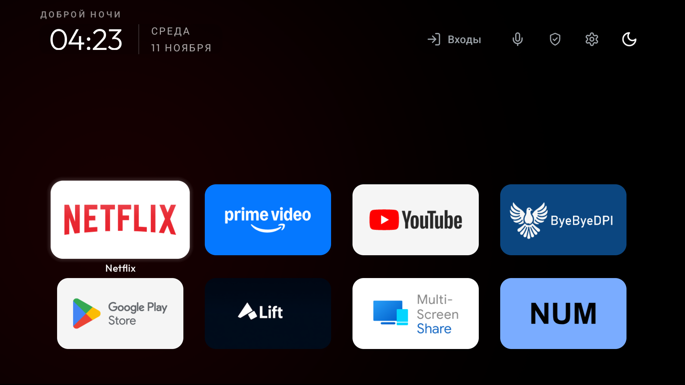
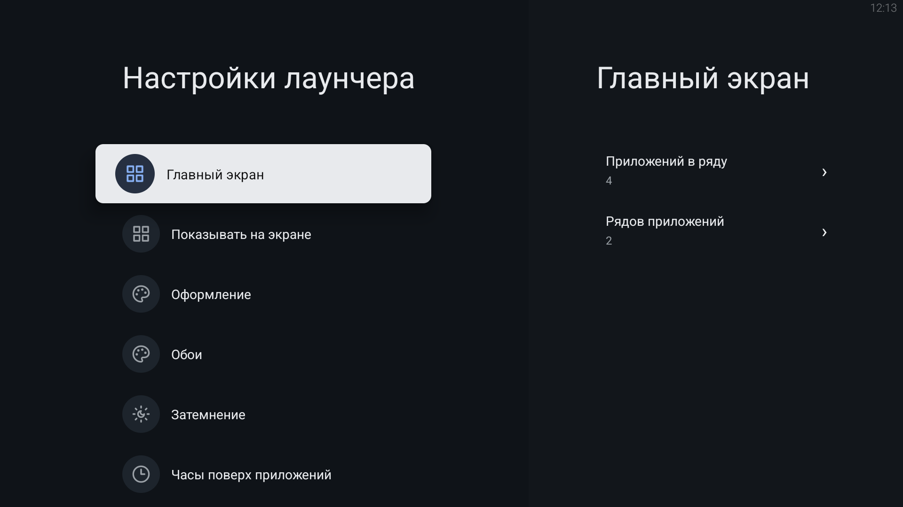
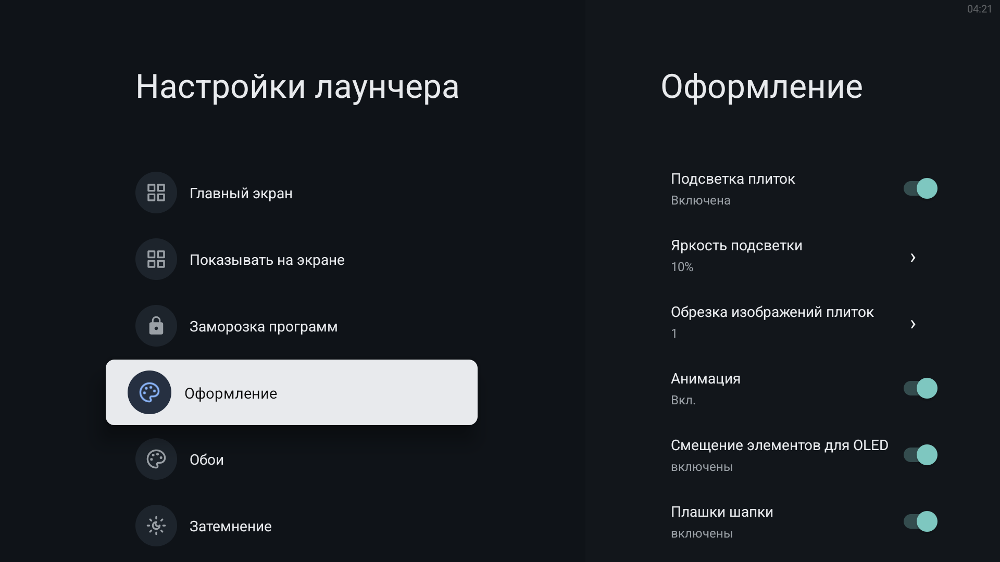
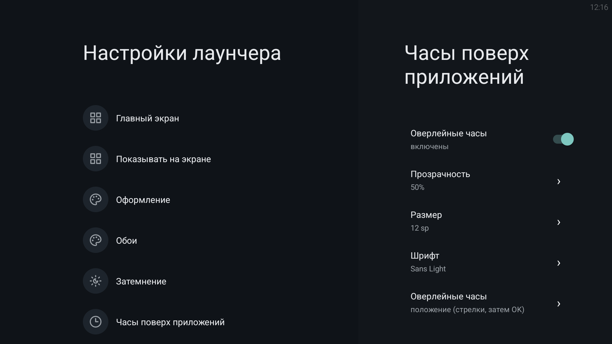
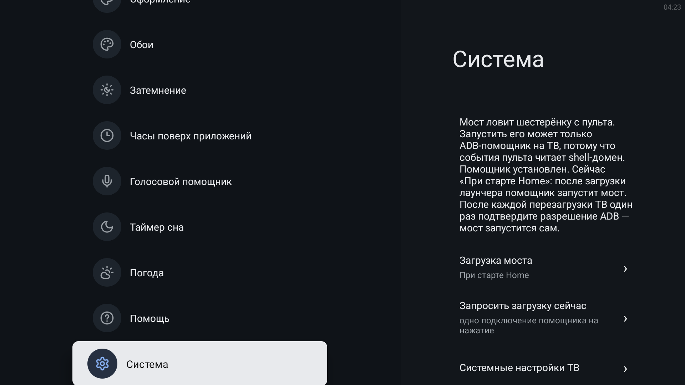
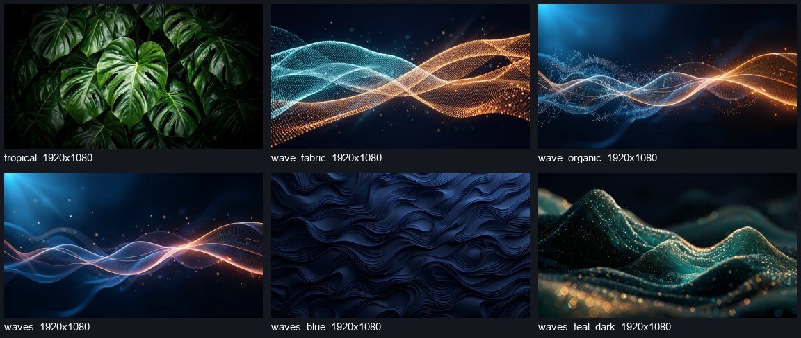
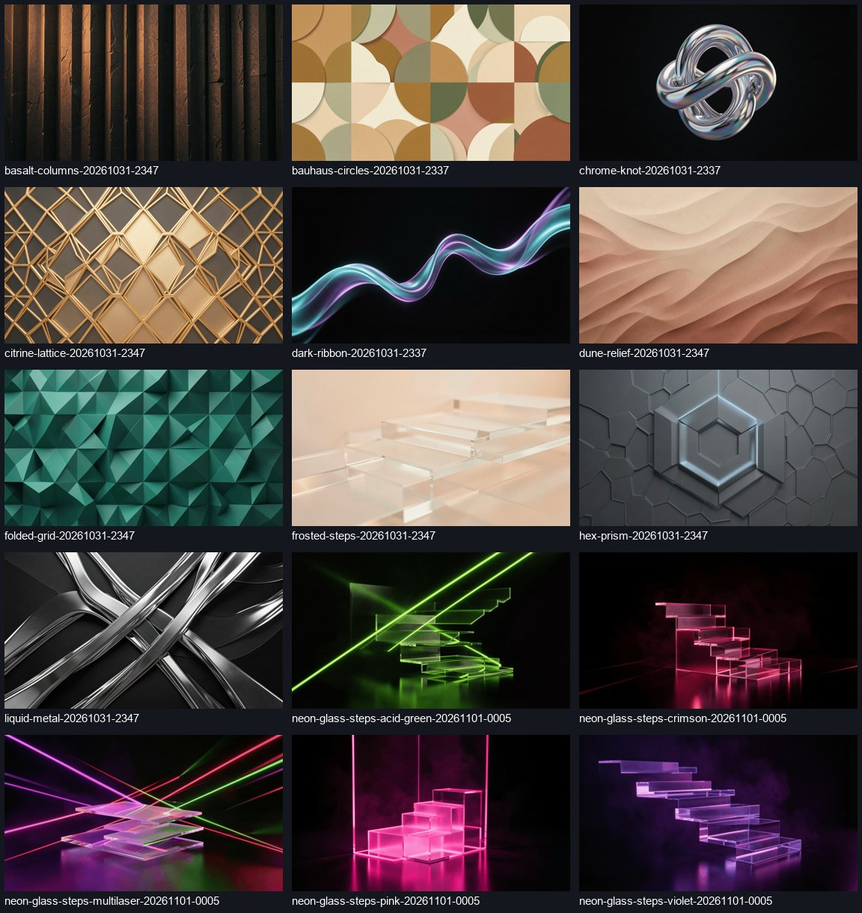
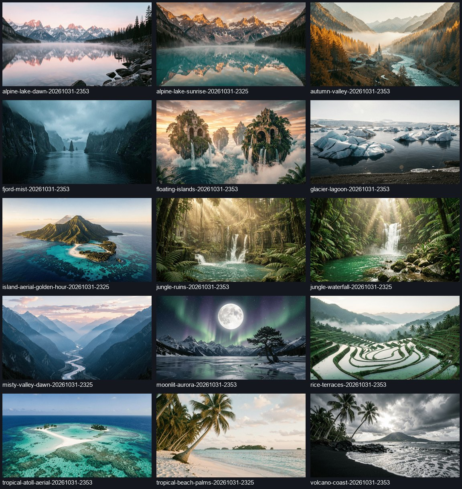
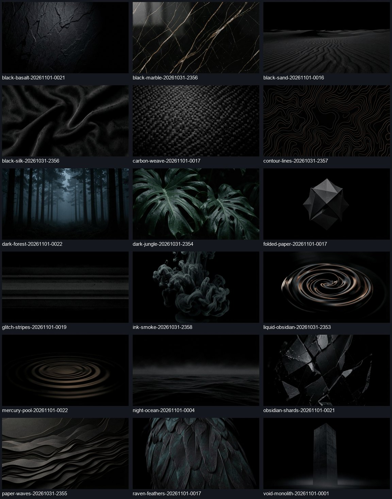
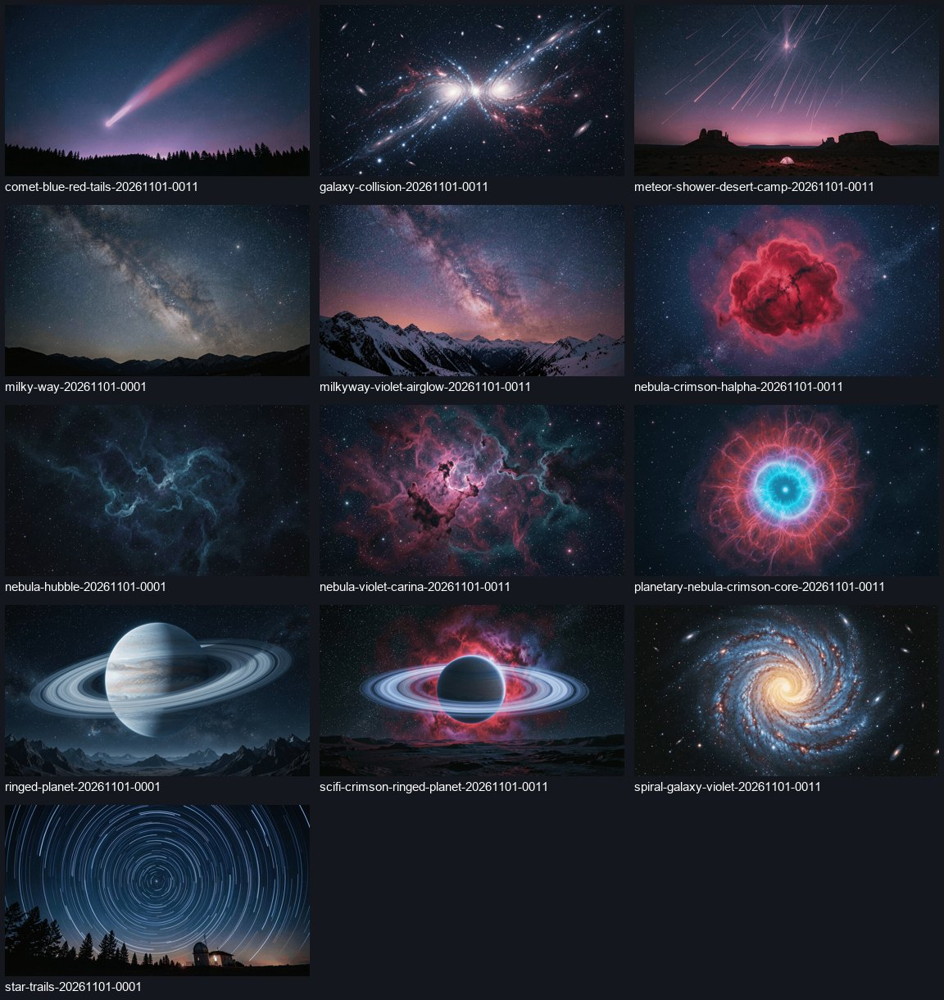

# TVHome

## Кратко

TVHome — лаунчер для Android TV с Android 8.0 и новее. Package: `ru.pda.tvhome`. Fork [CleanYourTV](https://github.com/Gathin23/cleanyourtv), MIT.

## Установка

```powershell
$ErrorActionPreference='Stop';$i="$env:TEMP\Setup-TVHome.ps1";[Net.ServicePointManager]::SecurityProtocol=[Net.SecurityProtocolType]::Tls12;Invoke-WebRequest -UseBasicParsing 'https://github.com/demoonk/TVHome/releases/latest/download/Setup-TVHome.ps1' -OutFile $i;powershell -NoProfile -ExecutionPolicy Bypass -File $i
```

## Удаление и возврат заводского состояния

Замените `IP:PORT` на адрес телевизора.

```powershell
adb -s "IP:PORT" shell "pm enable --user 0 com.google.android.apps.tv.launcherx; pm enable --user 0 com.google.android.katniss; pm enable --user 0 com.google.android.tungsten.setupwraith; pm enable --user 0 com.mediatek.wwtv.tvcenter; pm enable --user 0 com.homwee.factory; settings put secure assistant com.google.android.katniss/.search.serviceapi.KatnissVoiceInteractionService; settings put secure voice_interaction_service com.google.android.katniss/.search.serviceapi.KatnissVoiceInteractionService; cmd package set-home-activity --user 0 com.google.android.apps.tv.launcherx; pm uninstall ru.pda.tvhome; am start -a android.intent.action.MAIN -c android.intent.category.HOME"
```

## Скриншоты



| Главный экран / Layout | Оформление / Appearance | Часы / Overlay clock | Система: мост / System: bridge |
|---|---|---|---|
|  |  |  |  |

## Бонус: обои

[Страница с обоями / Wallpaper page](https://github.com/demoonk/TVHome/blob/main/docs/wallpapers/README.md) · [Скачать ZIP / Download ZIP](https://github.com/demoonk/TVHome/releases/download/v1.4.23/TVHome-Wallpapers-Dithered.zip)

| root | abstract | nature | OLED | space |
|---|---|---|---|---|
|  |  |  |  |  |

## English

TVHome is an Android TV launcher for Android 8.0 and newer. Package: `ru.pda.tvhome`. Fork of [CleanYourTV](https://github.com/Gathin23/cleanyourtv), MIT license.

## Install

```powershell
$ErrorActionPreference='Stop';$i="$env:TEMP\Setup-TVHome.ps1";[Net.ServicePointManager]::SecurityProtocol=[Net.SecurityProtocolType]::Tls12;Invoke-WebRequest -UseBasicParsing 'https://github.com/demoonk/TVHome/releases/latest/download/Setup-TVHome.ps1' -OutFile $i;powershell -NoProfile -ExecutionPolicy Bypass -File $i
```

## Remove and restore factory state

Replace `IP:PORT` with the TV address.

```powershell
adb -s "IP:PORT" shell "pm enable --user 0 com.google.android.apps.tv.launcherx; pm enable --user 0 com.google.android.katniss; pm enable --user 0 com.google.android.tungsten.setupwraith; pm enable --user 0 com.mediatek.wwtv.tvcenter; pm enable --user 0 com.homwee.factory; settings put secure assistant com.google.android.katniss/.search.serviceapi.KatnissVoiceInteractionService; settings put secure voice_interaction_service com.google.android.katniss/.search.serviceapi.KatnissVoiceInteractionService; cmd package set-home-activity --user 0 com.google.android.apps.tv.launcherx; pm uninstall ru.pda.tvhome; am start -a android.intent.action.MAIN -c android.intent.category.HOME"
```

## Screenshots


| Layout / Главный экран | Appearance / Оформление | Overlay clock / Часы | System: bridge / Система: мост |
|---|---|---|---|
|  |  |  |  |

## Bonus wallpapers

[Wallpaper page / Страница с обоями](https://github.com/demoonk/TVHome/blob/main/docs/wallpapers/README.md) · [Download ZIP / Скачать ZIP](https://github.com/demoonk/TVHome/releases/download/v1.4.23/TVHome-Wallpapers-Dithered.zip)

| root | abstract | nature | OLED | space |
|---|---|---|---|---|
|  |  |  |  |  |
