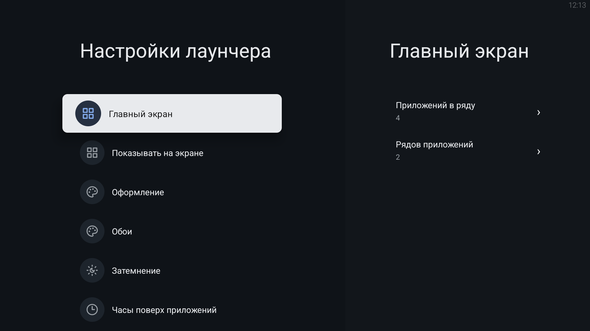
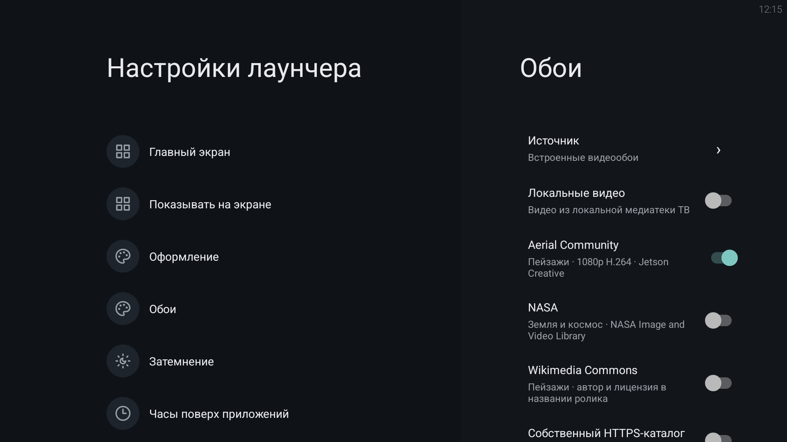
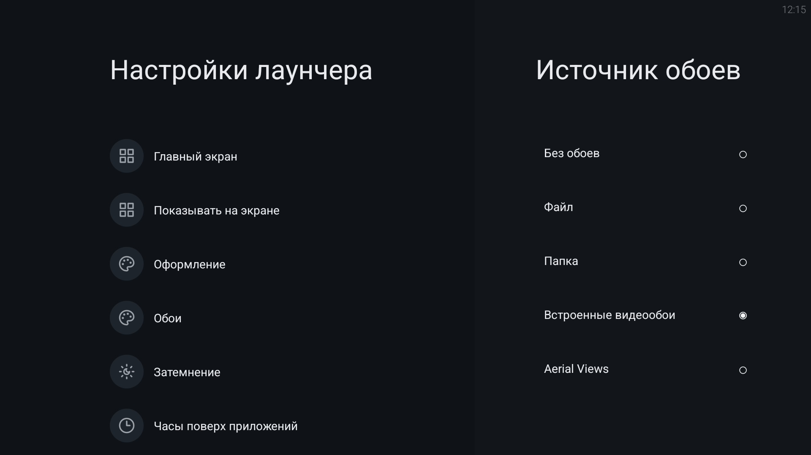
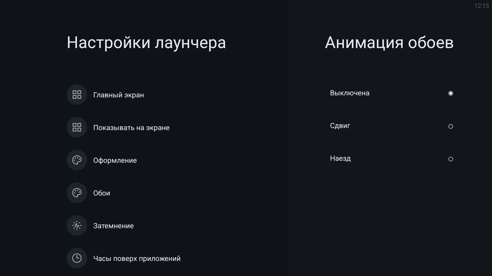
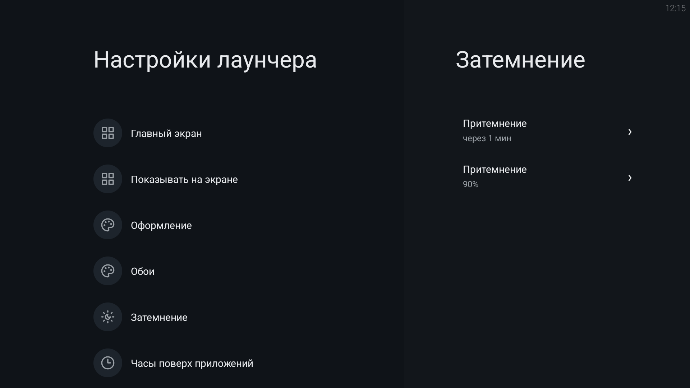
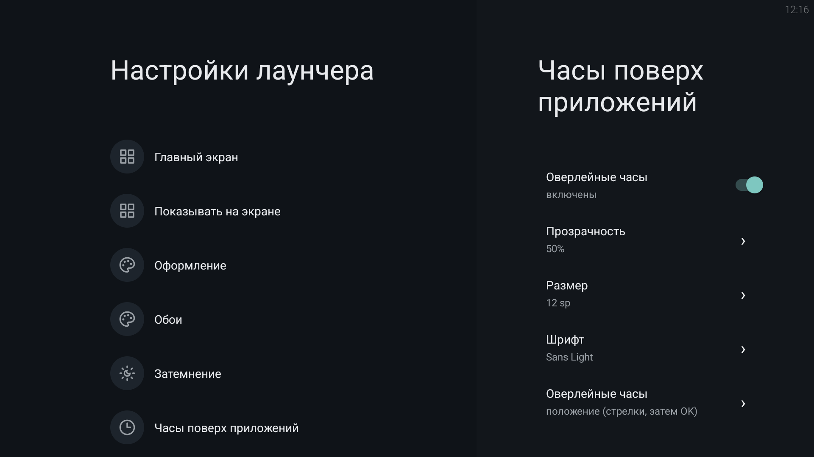

# Скриншоты и настройки / Screenshots and settings

9 настоящих снимков TVHome 1.4.23 с Android TV (AI PONT MAX FF, Android 14), 6 ноября 2026. Изображения интерфейса не перерисовывались. / Nine real captures from an Android TV running TVHome 1.4.23, November 6, 2026.

| | | |
|---|---|---|
| **Главный экран / Layout**  | **Оформление / Appearance**  | **Источники видеообоев / Video sources**  |
| **Режимы обоев / Wallpaper modes**  | **Сдвиг и наезд / Pan and zoom**  | **Затемнение / Dimming**  |
| **Часы / Overlay clock**  | **Помощь и обновления / Help and updates**  | **Поиск «Терминатор» / Terminator search**  |

## Настройки кратко / Settings at a glance

- **Главный экран / Layout:** число колонок и видимых рядов. / Columns and visible rows.
- **Оформление / Appearance:** подсветка, плашки, анимация интерфейса и OLED-смещение. / Glow, header plates, UI motion and OLED shift.
- **Обои / Wallpapers:** файл, папка, встроенные видеоисточники и Aerial Views; отдельное включение источников. / File, folder, built-in video sources and Aerial Views; individual source toggles.
- **Анимация обоев / Wallpaper animation:** выключена, сдвиг или наезд; 30–120 секунд на движение. / Off, pan or zoom; 30–120 seconds per movement.
- **Затемнение и часы / Dimming and clock:** задержка и уровень затемнения; размер, прозрачность, шрифт и положение часов. / Delay and dim level; clock size, opacity, font and position.
- **Помощь / Help:** версия, GitHub и ручная проверка обновлений. / Version, GitHub and a manual update check.

Поиск «Терминатор» на снимке вернул 19 карточек NUM и 4 карточки Кинопоиска. Постеры в момент съёмки не загрузились — видны штатные текстовые заглушки. / The captured Terminator search returned 19 NUM cards and 4 Kinopoisk cards. Poster images were unavailable during capture, so the original text placeholders are shown.
