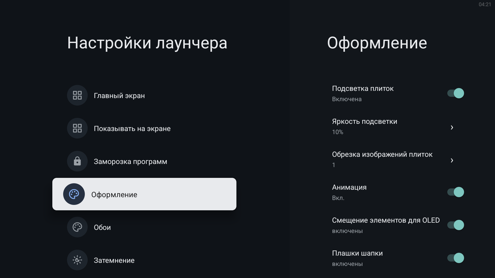
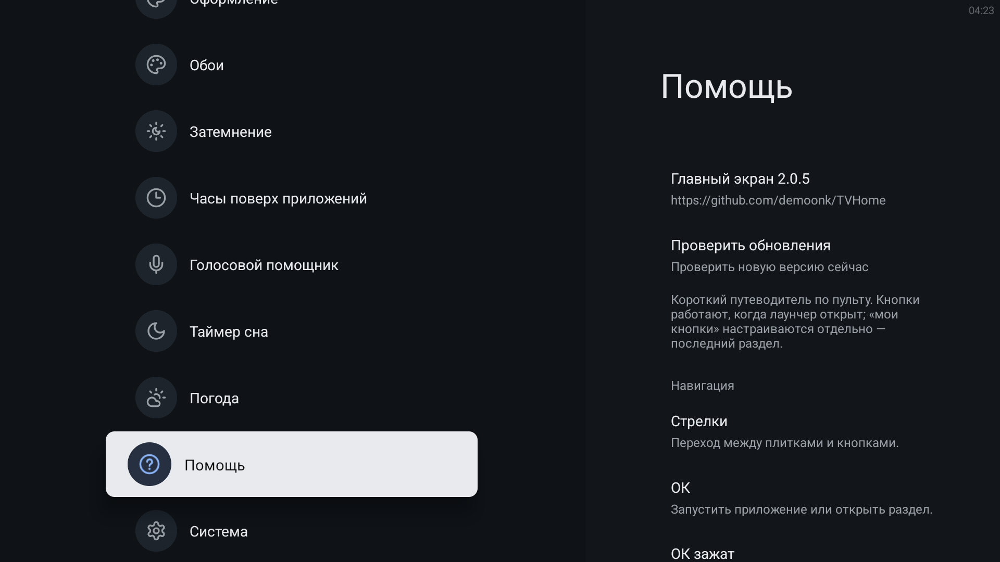
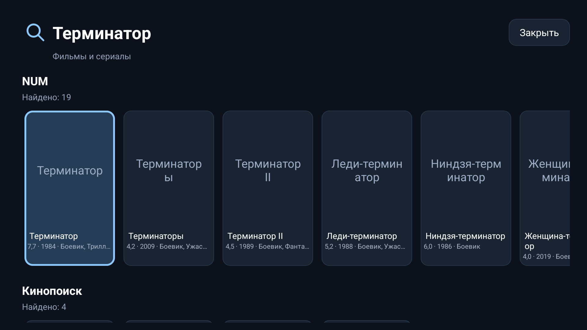
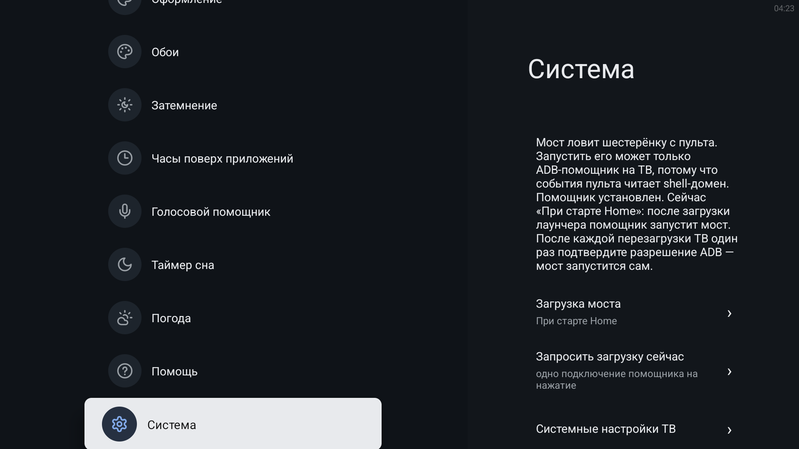

# Скриншоты и настройки / Screenshots and settings

Главный экран размещён отдельно в основном README; название города скрыто для публикации. / The main screen appears separately in the project README; the city name is hidden for publication.

**Снимки Home, «Главный экран», «Оформление», «Система» (мост шестерёнки) и «Помощь» — с настоящего ТВ на TVHome 2.0.5, 11 ноября 2026.** Остальные снимки (обои, затемнение, часы, поиск) сделаны ранее на 1.4.23 и показывают те же экраны. / The Home, Layout, Appearance, System (gear bridge) and Help captures are from a real TV running TVHome 2.0.5, November 11, 2026. The other captures (wallpapers, dimming, clock, search) are older 1.4.23 shots of the same screens.

| | | |
|---|---|---|
| **Главный экран / Layout**  | **Оформление / Appearance**  | **Источники видеообоев / Video sources**  |
| **Режимы обоев / Wallpaper modes**  | **Сдвиг и наезд / Pan and zoom**  | **Затемнение / Dimming**  |
| **Часы / Overlay clock**  | **Помощь и обновления / Help and updates**  | **Поиск «Терминатор» / Terminator search**  |

**«Система»: загрузка моста шестерёнки / System: gear bridge loading**

Строка «Загрузка моста» выбирает режим: «Вручную» или «При старте Home». С «При старте Home» после перезагрузки ТВ один раз спросит разрешение ADB (через 30–40 секунд после появления Home), после подтверждения мост запускается сам, и шестерёнка перехватывается. / The «Загрузка моста» row chooses the mode: manual or at Home start. With «При старте Home» the TV asks once for ADB permission after every reboot (30–40 seconds after Home appears); after the confirmation the bridge starts by itself and the gear button is intercepted.

## Настройки кратко / Settings at a glance

- **Главный экран / Layout:** число колонок и видимых рядов. / Columns and visible rows.
- **Оформление / Appearance:** подсветка, плашки, анимация интерфейса и OLED-смещение. / Glow, header plates, UI motion and OLED shift.
- **Обои / Wallpapers:** файл, папка, встроенные видео-источники и Aerial Views; отдельное включение источников. / File, folder, built-in video sources and Aerial Views; individual source toggles.
- **Анимация обоев / Wallpaper animation:** выключена, сдвиг или наезд; 30–120 секунд на движение. / Off, pan or zoom; 30–120 seconds per movement.
- **Затемнение и часы / Dimming and clock:** задержка и уровень затемнения; размер, прозрачность, шрифт и положение часов. / Delay and dim level; clock size, opacity, font and position.
- **Система / System:** режим загрузки моста шестерёнки, запрос загрузки и переход в системные настройки ТВ. / Gear bridge loading mode, a manual load request and a shortcut to system settings.
- **Помощь / Help:** версия, GitHub и ручная проверка обновлений. / Version, GitHub and a manual update check.
