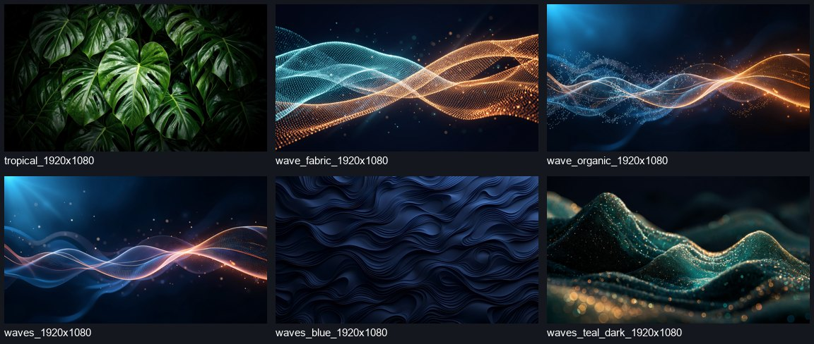
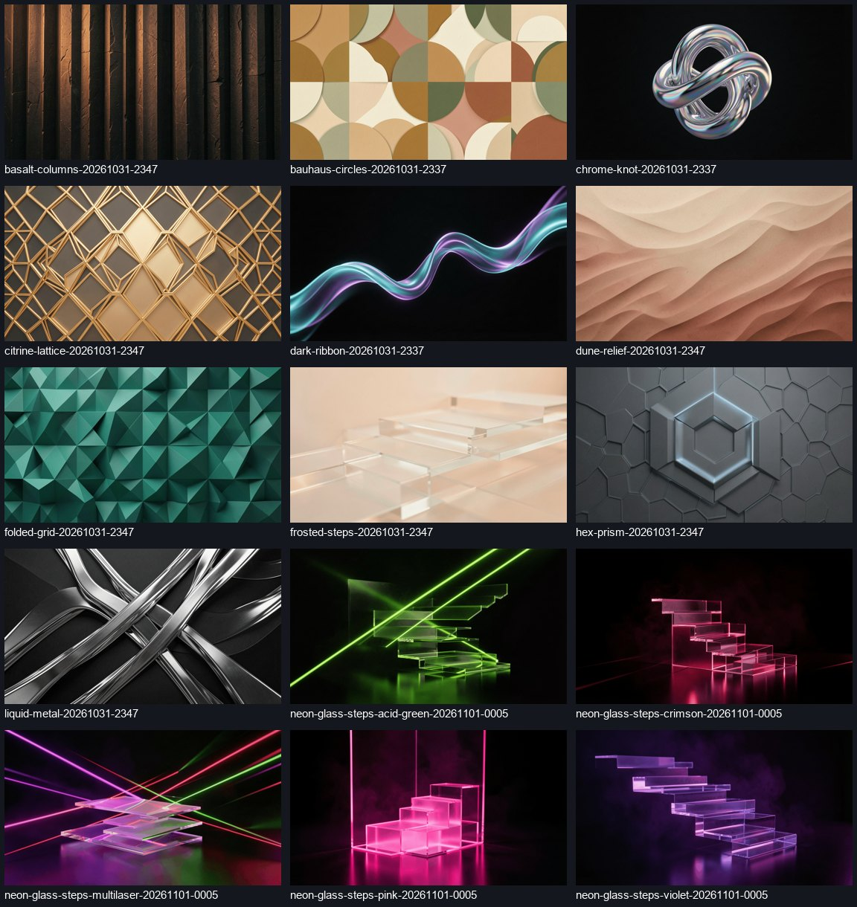
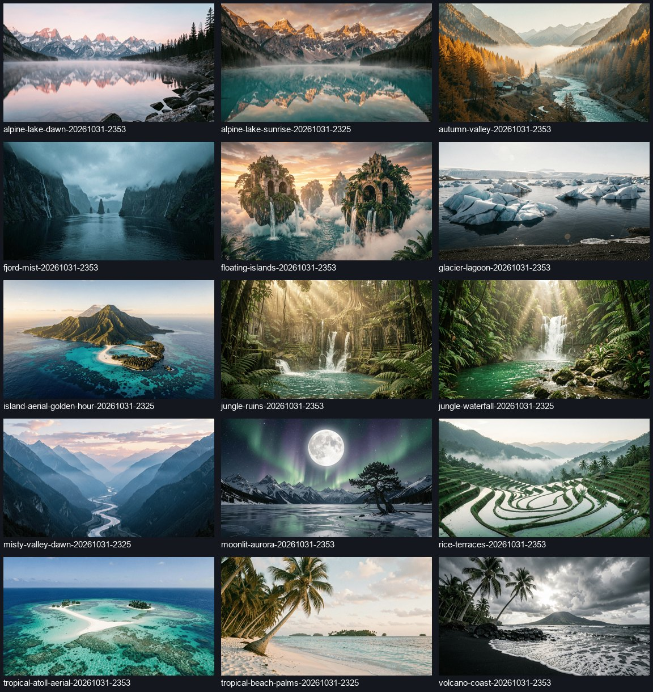
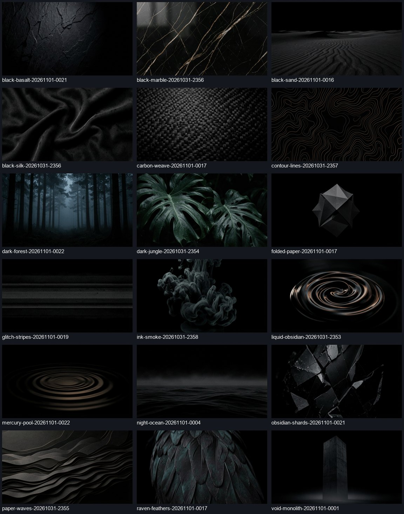
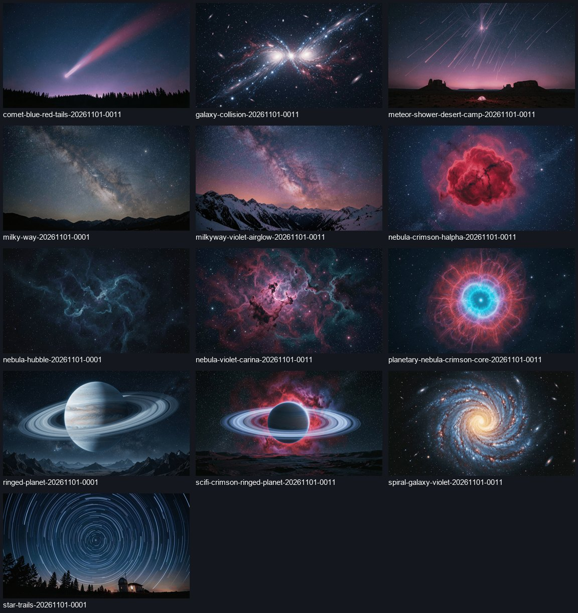

# Бонус: обои / Bonus wallpapers

[Скачать ZIP — 67 обоев / Download ZIP — 67 wallpapers](https://github.com/demoonk/TVHome/releases/download/v1.4.23/TVHome-Wallpapers-Dithered.zip)

Обои сделаны с дизерингом: мелкий шум сглаживает видимые ступеньки градиентов (banding), благодаря чему плавные переходы намного лучше смотрятся на ТВ. Итог зависит от панели и обработки изображения телевизором. В архиве оригинальные файлы и структура папок; превью ниже уменьшены.

Made with dithering to reduce visible gradient steps (banding), giving smoother gradients on TV. Results depend on the panel and TV image processing. The ZIP preserves the original files and folder structure; previews below are reduced in size.

Распакуйте архив и перенесите нужные изображения на ТВ. Выберите их в настройках обоев TVHome через источник «Файл». / Extract the archive, copy the images to your TV, and select them using the File wallpaper source in TVHome.

## Корневые файлы / Root files (6)

## abstract (15)

## nature (15)

## OLED (18)

## space (13)

